# LLM generation workflow
## Concepts
To produce more deterministic & reviewable output, this workflow is split into multiple prompts.
The basic outputs are as follows:

```mermaid
---
config:
  theme: dark
  layout: fixed
---
flowchart
subgraph Prompt 1
1A[Plot prose]-->1B[Scene brief]
end

subgraph Prompt 2
2A[Scene brief]-->2B[Audit findings]
end

subgraph Prompt 3
3A[Scene brief]-->3B[Tactical graph]
end

subgraph Prompt 4
4A[Tactical graph]-->4B[Audit findings]
end

subgraph Prompt 5
5A[Scene brief]-->5B[Tactical graph]
5B-->5B
end

subgraph Prompt 6
6A[Tactical graph]-->6B[Twee]
end

subgraph Prompt 7
7A[Tactical graph]-->7B[Twee]
7B-->7C[Audit findings]
end
```


## Workflow rules
Resolve source and output paths from the repository root; Markdown link targets are relative to this document. Locate code definitions by passage or symbol name rather than fixed line numbers.

Follow this multi-step workflow to generate and maintain the tactical graph using the `tactical-gen` skill and produce Twee with the `twee-gen` skill, staying faithful to `docs/Plot-Device.md`.

Resolve skills by name through the harness's available skill catalog and read their instructions when needed; availability does not mean the full instructions are already loaded. In Codex prompts, use `$tactical-gen` or `$twee-gen` to explicitly identify the relevant skill. Section references below refer to that installed skill's instructions.

For skill maintenance, edit the RuleSync sources below, then run `rulesync generate`:
- `.rulesync/skills/tactical-gen/SKILL.md`
- `.rulesync/skills/twee-gen/SKILL.md`

This workflow summarizes steps and refers to the named skills for their domain rules. Use the installed skills during execution; RuleSync source paths above are for maintenance.

### Coordinated author/reviewer execution
- The coordinator reads the full workflow, resolves the target scene and requested endpoint, and runs dependent stages sequentially. Use the active workspace by default; create an isolated trial only when requested.
- A fresh run overwrites the generated Scene Brief from canon and constraints using Prompt 1, audits it with Prompt 2, regenerates the target graph with Prompt 3 (`override=true` when the scene exists), and audits it with Prompt 4. Prompt 5 is for explicitly requested refactoring. Continue to Prompts 6–7 only when requested.
- Human checkpoint: run brief generation, brief audit, graph generation/refactoring, and their bounded repair loops automatically through Prompt 4. Do not schedule a routine human checkpoint after the brief. After graph review, present the candidate graph, constraint verdicts, remaining findings, and meaningful changes, then stop for the user to evaluate the scene before dialogue generation or another scene begins. An earlier requested endpoint or an unresolved conflict still stops the run sooner.
- Content generation is iterative, one target scene at a time. At the graph checkpoint, the user may refine authored context/constraints and request a fresh rewrite, request a targeted refactor, or approve the graph and request dialogue. Every revised graph returns through Prompt 4 and the human graph checkpoint. A graph audit PASS does not itself approve the narrative experience. Unless the user explicitly waives this checkpoint, a request for the full workflow still pauses here.
- Launch each initial prompt task and every audit/re-audit in a fresh subagent context without copying the coordinator conversation or another worker's history. In a harness supporting `fork_turns`, use `fork_turns="none"`. If that isolation is unavailable, report the limitation before proceeding; an instruction to forget earlier work does not clear history. System and project guidance still apply.
- Give each worker its designated prompt, applicable phase ownership and parameterization, relevant installed skill instructions, authoritative source paths, and shared narrative rules plus only the target scene's constraints. Do not require workers to read the full workflow. Include referenced requirements needed to execute the task; do not omit them merely to reduce context.
- Scene constraints live in `docs/narrative-rules.md`, outside generated artifacts. Load them for briefs, graphs, dialogue, and their reviews. They survive regeneration and are not additional Scene Brief JSON fields or plot-anchor sources.
- Reviewers for Prompts 2, 4, and 7 are read-only: return findings, never applied fixes. Do not send them author reasoning, self-verification claims, or prior audit verdicts. They independently inspect current artifacts and canonical requirements.
- Every audit reports each applicable scene constraint as PASS, FAIL, or NOT VERIFIED with evidence. Separate confirmed violations (rule, affected field/ID/edge, evidence, minimal correction), optional creative suggestions, and limitations. Brief review may defer graph-dependent reachability; graph review must supply paths and state/visit evidence; Twee review must check the implementation against those constraints. A parser/compiler success alone does not establish narrative or runtime correctness.
- The coordinator routes confirmed violations to the owning author for minimal repairs; that author may retain its stage context for repairs. Preserve passing values and IDs during repairs. Re-audit in a fresh context before advancing. After two unsuccessful repair rounds for a stage, report unresolved findings for discussion. Optional creative suggestions do not block progression.
- Authored hard constraints take precedence over optional heuristics. If hard requirements conflict, report the conflict rather than silently weakening either. Replacing a generated artifact does not authorize editing its source constraints.
- Finish with stage verdicts, checks actually performed, remaining WIP/limitations, and changed paths. Model reviews are evidence-based judgments, not deterministic guarantees.

Example invocation: "Run a fresh coordinated workflow for `c01.s01` through Prompt 4 using `docs/Workflow.md`. Use subagents with fresh contexts and write results in this workspace." This invokes Prompt 3 with `override=true` for an existing scene; it does not invoke Prompt 5.

### Phase ownership
- Prompt 1 and its author repairs write only `docs/briefs/{SCENE_ID}.json`; Prompt 2 is read-only.
- Prompts 3 and 5 and their author repairs write the target scene and required model-scope handoff in `docs/workspace.dsl`. They may add only missing chapter/scene/entry declarations for its planned successor under tactical-gen's Development boundaries policy; preserve existing successor content and unrelated scenes. The existing-scene regeneration guard below still applies.
- Prompt 4 is read-only.
- Prompt 6 and its author repairs write `src/{SCENE_ID}.twee`, including allowed handoff stubs. They may also remove exact-title `[stub]` passages from other scene files when superseded or duplicated, preserving every other passage. Prompt 7 is read-only. The DSL, plot sources, briefs, and shared narrative references remain read-only. Reuse `src/main.twee`; shared-code changes require a requested feature that needs them under the State lifecycle contract.
- Both graph and dialogue phases read the single shared reference `docs/narrative-rules.md`, including its Player agency section, without invoking the other phase's generation instructions.
- Graph defects found during Prompts 6–7 produce a report with affected IDs and a proposed minimal DSL correction, not a graph edit. Continue with unblocked content when useful, identify incomplete output, and do not invent graph semantics or claim full verification. Apply graph corrections in a separately requested graph phase before completing affected Twee branches.
- If the user's request includes graph repair and Twee generation, perform the graph phase first. This technical ownership boundary does not itself require approval, but the human graph checkpoint above still applies before proceeding to Twee unless the user explicitly waives it.

## Prompt Parameterization
- Use a `SCENE_ID` in DSL format `cNN.sNN` (e.g., `c01.s01`).
- Invoke each step with: "Execute Prompt N for `SCENE_ID`" (e.g., "Execute Prompt 1 for `c01.s01`").
- Persist artifacts using `SCENE_ID`:
  - Scene Brief JSON: `docs/briefs/{SCENE_ID}.json` (e.g., `docs/briefs/c01.s01.json`)
  - Twee output: `src/{SCENE_ID}.twee` (e.g., `src/c01.s01.twee`)
- Fresh attempts: regenerate and overwrite the target brief and graph. If the scene already exists, the coordinator explicitly invokes Prompt 3 with `override=true`, e.g., "Execute Prompt 3 for `c01.s01` override=true". Preserve unrelated scenes, existing successor content, and boundary IDs required by incoming handoffs. Do not reuse the prior output as the creative template. Explicit refactoring requests use Prompt 5 instead.
- Expanding a placeholder-only scene is normal Prompt 5 refactoring: preserve its entry ID and incoming handoffs, remove the stub marker, and author the scene. `override=true` is not required solely because the scene began as a placeholder.

# Prompts
## Prompt 1 — Produce a Scene Brief (JSON only)
Output strict JSON (no prose) capturing anchors, non‑verbal actions, and thresholds for a single scene.

Suggested prompt:
```text
Using the `tactical-gen` skill and `docs/Plot-Device.md`, produce a Scene Brief in strict JSON (no prose, no comments) for `SCENE_ID`.

Scene Brief source resolution: follow the Scene source resolution policy in the `tactical-gen` skill.

Fields:
{ "chapter": "<chapter-name>", "scene": "<scene-name>", "anchors": [], "actions": [], "thresholds": { "angerHigh": 0, "stressHigh": 0 }, "quotas": { "anchor60": true, "doubleAnchor30": true } }

Requirements:
- anchors: 8–12 items. Resolve the allowed source pool for `SCENE_ID` using the Scene source resolution policy in the `tactical-gen` skill. Anchors must be unique exact substrings from that allowed source pool, with no inventions.
- actions: 10–14 non‑verbal action labels. Follow the Player agency and action vocabulary rules and Supportive listener posture in the `tactical-gen` skill.
- thresholds: choose `angerHigh` and `stressHigh` per the Adaptive Threshold Policy and First-run scope in the `tactical-gen` skill.
- quotas: anchor60 and doubleAnchor30 set true.
- Do NOT add any extra properties. Specifically, do not include any DSL snapshots or large text blobs in the brief; the DSL belongs only in `docs/workspace.dsl`.
```

Invocation: Execute Prompt 1 for `SCENE_ID`.

Overwrite `docs/briefs/{SCENE_ID}.json` with the newly generated JSON (version history is maintained by Git). Reference this file in later prompts (no pasting).

## Prompt 2 — Independently audit the Scene Brief JSON
Validate the Scene Brief JSON against required schema and constraints before generating the DSL. Report violations for the Prompt 1 author to repair, then re-audit before proceeding.

Suggested prompt:
```text
Audit the Scene Brief at `docs/briefs/{SCENE_ID}.json` against the `tactical-gen` skill and `docs/Plot-Device.md`. Report findings only; all files are read-only. Include the scene-constraint verification required by Coordinated author/reviewer execution.

Scene Brief source resolution: follow the Scene source resolution policy in the `tactical-gen` skill.

Propose corrections only for fields that violate checks; preserve all other values and their order. Do not propose metadata fields, reordered arrays, or rewritten anchors/actions that pass checks.

Checks:
- Fields present: chapter, scene, anchors, actions, thresholds.angerHigh, thresholds.stressHigh, quotas.anchor60, quotas.doubleAnchor30. No extra properties.
- anchors: 8–12 items; unique; exact substrings from the allowed source pool for `SCENE_ID`, resolved per the Scene source resolution policy in the `tactical-gen` skill; no inventions.
- actions: 10–14 items; comply with the Player agency and action vocabulary rules in the `tactical-gen` skill.
- thresholds: angerHigh and stressHigh selected per Adaptive Threshold Policy (range and intent validated).
- quotas: anchor60=true, doubleAnchor30=true (exact values).
- Strings non‑empty; consistent casing and spelling; no comments or prose.

Output:
1) Violations (bullets)
2) Minimal proposed corrections, scene-constraint results, optional suggestions, and limitations (no applied edits)
```

Invocation: Execute Prompt 2 for `SCENE_ID`.

If corrections are needed, return findings to the Prompt 1 author, update only failing fields, and obtain a fresh Prompt 2 review before proceeding.

## Prompt 3 — Generate the Tactical Graph DSL from the Brief
Use the Brief to emit only the Structurizr DSL for `SCENE_ID`.

Fresh runs use Prompt 3. If the `SCENE_ID` block exists, invoke it explicitly with `override=true`; use Prompt 5 only for a requested refactor.

Suggested prompt:
```text
Using the `tactical-gen` skill, the Scene Brief at `docs/briefs/{SCENE_ID}.json`, and the header conventions in `docs/workspace.dsl`, generate ONLY the Structurizr DSL for `SCENE_ID`.

Enforce (see the `tactical-gen` skill — single source of truth):
- Descriptions 100–200 chars; complete sentences; anchor quotas.
- Non‑verbal actions only. Labels: `Act: ...` and `timer` only; ≥6 distinct verbs.
- 12–16 authored components with ≥2 Game Over nodes in a developed scene; exclude marked WIP placeholders from content quotas.
- Timers on ordinary non-GO passages; ≥1 explicit user-choice GO (one unconditional). Marked WIP stops and intentional endings follow Development boundaries in the `tactical-gen` skill.
- Early Game Over pacing: follow `Early Game Over pacing` in the `tactical-gen` skill.
- First-run scope: follow `First-run scope` in the `tactical-gen` skill.
- Survival/risk posture: follow `Supportive listener posture` in the `tactical-gen` skill.
- GO narrative semantics: follow `Game Over meaning` in the `tactical-gen` skill.
- GO respawn policy: GO → respawn (regular passage) → P01; direct GO→P01 disallowed.
- Use `visited(...)` sparingly (1–2 unlocks), reachable within 1–2 iterations.
- Integer stat deltas; clamp [0,100]; spikes ≤20 only directly before GO.
- Preserve steady pacing: early failure should accelerate discovery, and respawn routing should quickly return the player to meaningful decision points.
- Cross‑scene handoff: follow the Cross‑scene handoff policy in the `tactical-gen` skill.
- Object‑intro passages: follow the Object‑intro passages policy in the `tactical-gen` skill.

Output the `cNN { sNN { ... } }` DSL block for `SCENE_ID`, and write the required handoff for a developed continuing scene. Follow Cross-scene handoff and Development boundaries in the `tactical-gen` skill: a planned undeveloped successor gets a minimal declared `Passage-Stub` entry; an explicitly final scene gets no successor handoff. Do not invent successors. Report created or remaining WIP scene IDs.

Run `structurizr validate -w docs/workspace.dsl` for DSL syntax validation. If only the legacy CLI is installed, use `structurizr-cli validate -w docs/workspace.dsl` and report which command ran. Check the exit code and diagnostic output; separate warnings from validation errors. This does not replace state/reachability or scene-constraint checks.
```

Invocation: Execute Prompt 3 for `SCENE_ID`. To regenerate an existing scene, use: "Execute Prompt 3 for `SCENE_ID` override=true".

## Prompt 4 — Independently audit the Tactical Graph
Run a read-only validation pass. Return confirmed violations to the Prompt 3 or Prompt 5 author for repair and a fresh re-audit.

Suggested prompt:
```text
Audit the `SCENE_ID` block in `docs/workspace.dsl` against the `tactical-gen` skill and the Scene Brief at `docs/briefs/{SCENE_ID}.json`. Report findings only; all files are read-only. Include the scene-constraint verification required by Coordinated author/reviewer execution.

Checks: see these sections in the `tactical-gen` skill:
- Quality checks (hard requirements).
- Development boundaries (WIP placeholders and endings): distinguish marked WIP and ending stops from accidental dead-ends, and exclude placeholder-only successors from full-scene gameplay checks.
- Adaptive Threshold Policy (anger/stress).
- Cross‑scene handoff policy (canonical).
- Object‑intro passages (procedural).
- Supportive listener posture and Game Over meaning.
If any referenced policy fails, propose a minimal correction for the owning author. Proposed scope is the `SCENE_ID` block and its required handoff; only minimal missing successor declarations permitted by Development boundaries may be proposed outside it. Preserve component IDs and existing successor content, and avoid extra nodes unless a rule requires them. Do not edit the DSL.

Output:
1) Violations (bullets)
2) Minimal proposed corrections, scene-constraint results with reachability evidence, optional suggestions, and limitations (no applied edits)
```

Invocation: Execute Prompt 4 for `SCENE_ID`.

## Prompt 5 — Refactor existing scene (optional)
Use this when updating an existing graph without adding unnecessary nodes.

Suggested prompt:
```text
Transform the `SCENE_ID` block in `docs/workspace.dsl` to comply with the `tactical-gen` skill and the Scene Brief:

Inputs (read by path; do not paste contents):
- `docs/workspace.dsl` (use block for `SCENE_ID`)
- `docs/briefs/{SCENE_ID}.json`

Tasks:
- Replace any speech‑like actions (e.g., "Act: Ask about her") with non‑verbal, object‑anchored actions from the Brief.
- Ensure every ordinary non-GO passage has ≥1 outgoing timer; explicitly marked WIP and ending stops follow Development boundaries in the `tactical-gen` skill. Enforce the Timer & Respawn rules: GO nodes emit only `Act: Respawn` to respawn passages, and respawn passages own the unconditional `timer` back to `p01_rg`.
- Ensure the scene still satisfies `Early Game Over pacing` and `First-run scope` from the `tactical-gen` skill.
- Align survivable and risky branches with `Supportive listener posture` in the `tactical-gen` skill.
- If multiple deaths are semantically redundant, revise them to satisfy `Game Over meaning` in the `tactical-gen` skill.
- Enforce 100–200 char descriptions and anchor quotas; keep node IDs stable; don’t bloat node count.
Output ONLY the updated DSL block.
```

Invocation: Execute Prompt 5 for `SCENE_ID` when needed.

## Prompt 6 — Generate Twee from the Tactical Graph
Convert the validated tactical graph into SugarCube v2 Twee passages for the specified scene.

Suggested prompt:
```text
Using the `twee-gen` skill, read the scene graph for `SCENE_ID` from `docs/workspace.dsl` and generate the corresponding SugarCube v2 Twee passages.

Inputs (read by path; do not paste contents):
- `docs/workspace.dsl` (use `SCENE_ID`)
- `src/main.twee` (macros and globals)
- `docs/sugarcube-2_docs/` (reference only)

Follow the rules in the `twee-gen` skill. Respect passage IDs and cross-refs defined in `docs/workspace.dsl`.
Implement GO fan‑out on GO passages: GO shows conditional links to respawn targets (regular passages) using the same conditions as the DSL (e.g., `visited(...)`). Do not include any Restart link. Respawn passages route to default entry (e.g., `c01.s01.P01`) via their own timers.

Create or replace `src/{SCENE_ID}.twee` with ONLY Twee passages:
- from the currently specified scene.
- connecting into the next scene.
  - For each cross‑scene handoff present in the DSL, add exactly one handoff from its source passage to the designated next scene.
  - Mirror the DSL edge label and condition: if `"timer"`, use a timed auto‑advance; if `"Act: X"`, add a user link labeled `X`; include any conditions (e.g., `Anger`/`Stress` thresholds) in SugarCube conditionals.
  - Cross‑scene handoffs MAY use `timer`, but prefer `Act: ...` when meaningful player agency exists.
  - Target ID mapping and Twee passage naming: follow the canonical title mapping in the `twee-gen` skill: `cNN.sNN.pNN_<kind>` → `cNN.sNN.PNN`, preserving dots and using the component's uppercase passage-name. Apply it to declarations, links, timed transitions, visit checks, handoffs, and stubs; preserve existing image asset paths.
  - Stub lifecycle: follow the `twee-gen` skill. Search all `src/*.twee` declarations first; reuse real targets or an existing exact-title stub. Only when a declared DSL target has no Twee definition, add one `[stub]` in this file with explicit WIP/To be continued text, no state changes, and no outgoing links or timer. Never invent a missing DSL target. When developing the target scene, preserve its title and incoming links and remove superseded tagged stubs, including an embedded stub in a predecessor file; leave other passages untouched.
  - Monologue expansion: authored non-GO, non-stub passages include at least one narrator line and an unrestricted, immersive Leon monologue (multiple `.dialogue` paragraphs as needed), grounded in anchors from `docs/Plot-Device.md`. Game Overs may be brief; Leon's dialogue is optional. They require a clear consequence, narrative value under the shared narrative rules, and visible DSL-mapped Respawn links. Stubs are exempt; render declared intentional endings as `[ending]` passages without onward progression.
  - State lifecycle: follow the `twee-gen` skill. `StoryInit` initializes fresh-game defaults; `Start` only routes to the default entry without resetting state. Each contextual respawn applies `stress = floor(stress / 2)` and `anger = 0` exactly once, preserving visit history, replay discoveries, and other globals. Entry passages apply normal effects without reinitialization. GO passages expose respawn links without performing resets. Reuse existing globals; change shared initialization only when the requested feature requires it.
```

Invocation: Execute Prompt 6 for `SCENE_ID`.

## Prompt 7 — Independently verify Twee against the Tactical Graph
Ensure the generated Twee branches in `src/{SCENE_ID}.twee` exactly correspond to affecting & effecting relationships for `SCENE_ID`'s graph in `docs/workspace.dsl`. Report mismatches for the Prompt 6 author to repair; report source-of-truth conflicts with `docs/Plot-Device.md`. All files are read-only during this audit.

Suggested prompt:
```text
Audit `src/{SCENE_ID}.twee` against:
- the `twee-gen` skill
- the `tactical-gen` skill's graph-validation rules (read-only)
- `docs/workspace.dsl` (scene: `SCENE_ID`)
- `docs/Plot-Device.md`

Include applicable scene constraints from `docs/narrative-rules.md` and report their verification explicitly. Requests below to add, render, or remove content are requirements to check and propose to the author; do not apply edits.

Important:
DSL & Sugarcube syntax is intentionally different. Focus only on logical differences.

Tasks:
1) Build an adjacency list for `SCENE_ID` (components and edges with labels & conditions).
2) Parse `src/{SCENE_ID}.twee` and extract passage links and timed progressions.
3) Enforce the mapping rules from Prompt 6:
   - Scope: the file contains ONLY passages for the specified scene plus connections into the next scene.
   - Handoffs: for each cross‑chapter relationship in the DSL, add exactly one handoff from its source passage to the designated next scene.
   - Edge modality: mirror DSL edge labels and conditions — if "timer", use a timed auto‑advance; if "Act: X", use a user link labeled X; include any `Anger`/`Stress` thresholds via SugarCube conditionals.
   - Target ID mapping: use the same canonical title mapping as Prompt 6 (the `twee-gen` skill): `cNN.sNN.pNN_<kind>` → `cNN.sNN.PNN`. Check declarations, links, timed transitions, visit checks, handoffs, and stubs; leave already-valid titles and existing image asset paths unchanged.
   - Stub lifecycle: each declared target resolves to exactly one real passage or `[stub]` across all `src/*.twee` files. Stubs show explicit WIP/To be continued text, contain no state changes or onward links/timer, and cannot hide missing DSL declarations or graph errors. Prefer real content and remove superseded/duplicate tagged stubs only; report conflicting real definitions. List remaining WIP targets separately from errors and completed content.
4) Dialogue expansion checks:
   - Each authored non-GO passage contains substantive, multi-line Leon monologue (not a single-sentence body); length is not capped. Prefer `.dialogue` paragraphs. `[stub]` passages are exempt; declared `[ending]` passages may stop without choices or timers.
   - GO passages include a consequence line and visible Respawn links only (no Restart).
4) Compare both graphs:
   - Missing or extra passages or edges
   - Label mismatches (`Act: ...`), timer presence, and conditions (`Stress`/`Anger` thresholds)
   - Game Over targets and counts
   - Stat delta consistency per passage (match intent and magnitude bands)
   - ID format and cross‑ref mapping correctness
   - Handoff presence/count and stub existence/tagging
5) Source-of-truth policy:
   - If `src/{SCENE_ID}.twee` deviates from `docs/workspace.dsl`, prefer the DSL and propose a Twee correction to its author.
   - If the DSL is invalid, incomplete, or contradicts `docs/Plot-Device.md` themes or anchors, follow Phase ownership: report affected IDs and propose minimal DSL edits without applying them. A matching Twee diff may be proposed, but do not apply speculative changes to affected branches or claim full verification before the graph correction is authorized and applied in the graph phase.

Output:
1) Violations (bullets) grouped by type (structure, labels, timers, conditions, stats, ids/handoffs/stubs)
2) Proposed corrections for affected passages, scene-constraint results, optional suggestions, and limitations (no applied edits)
```

Invocation: Execute Prompt 7 for `SCENE_ID`.

## File-aware agent usage — reference files instead of pasting
- In a file-aware agent, reference files by path (e.g., `docs/briefs/{SCENE_ID}.json`, `docs/workspace.dsl`, `src/{SCENE_ID}.twee`) directly in prompts.
- Reference skills by name and relevant section, as above; the harness resolves their installed locations. Reference source and output artifacts by path.
- If working without a file-aware agent, you may paste JSON/DSL snapshots in the chat for discussion, but never persist DSL snapshots inside Scene Brief JSON files. The authoritative rule lives in the `tactical-gen` skill.
