# LLM generation workflow
## Concepts
To produce more deterministic & reviewable output, this workflow is split into multiple prompts.
The basic outputs are as follows:

```mermaid
---
config:
  theme: dark
  layout: fixed
---
flowchart
subgraph Prompt 1
1A[Plot prose]-->1B[Scene brief]
end

subgraph Prompt 2
2A[Scene brief]-->2A
end

subgraph Prompt 3
3A[Scene brief]-->3B[Tactical graph]
end

subgraph Prompt 4
4A[Tactical graph]-->4A
end

subgraph Prompt 5
5A[Scene brief]-->5B[Tactical graph]
5B-->5B
end

subgraph Prompt 6
6A[Tactical graph]-->6B[Twee]
end

subgraph Prompt 7
7A[Tactical graph]-->7B[Twee]
7B-->7B
end
```


## Workflow rules
Resolve source and output paths from the repository root; Markdown link targets are relative to this document. Locate code definitions by passage or symbol name rather than fixed line numbers.

As a developer, follow this constrained, multi-step LLM prompting workflow to generate and maintain the tactical graph (defined in `.rulesync/skills/tactical-gen/SKILL.md`) while staying faithful to the context in `docs/Plot-Device.md`.

RuleSync source of truth for skills (per domain); edit these files, then run `rulesync generate`:
- `.rulesync/skills/tactical-gen/SKILL.md`
- `.rulesync/skills/twee-gen/SKILL.md`

This workflow summarizes steps and references those files rather than duplicating rule text. When in doubt, defer to said files.

### Phase ownership
- Prompts 1–2 write only `docs/briefs/{SCENE_ID}.json`.
- Prompts 3–5 write the target scene and required model-scope handoff in `docs/workspace.dsl`. They may add only missing chapter/scene/entry declarations for its planned successor under tactical-gen's Development boundaries policy; preserve existing successor content and unrelated scenes. The existing-scene regeneration guard below still applies.
- Prompts 6–7 write `src/{SCENE_ID}.twee`, including allowed handoff stubs. They may also remove exact-title `[stub]` passages from other scene files when superseded or duplicated, preserving every other passage. The DSL, plot sources, briefs, and shared narrative references remain read-only. Reuse `src/main.twee`; shared-code changes require a requested feature that needs them under the State lifecycle contract.
- Both graph and dialogue phases read the single shared reference `docs/narrative-rules.md`, including its Player agency section, without invoking the other phase's generation instructions.
- Graph defects found during Prompts 6–7 produce a report with affected IDs and a proposed minimal DSL correction, not a graph edit. Continue with unblocked content when useful, identify incomplete output, and do not invent graph semantics or claim full verification. Apply graph corrections in a separately requested graph phase before completing affected Twee branches.
- If the user's request already includes graph repair and Twee generation, perform the graph phase first and then generate from the corrected graph; this ownership boundary does not require another approval.

## Prompt Parameterization
- Use a `SCENE_ID` in DSL format `cNN.sNN` (e.g., `c01.s01`).
- Invoke each step with: "Execute Prompt N for `SCENE_ID`" (e.g., "Execute Prompt 1 for `c01.s01`").
- Persist artifacts using `SCENE_ID`:
  - Scene Brief JSON: `docs/briefs/{SCENE_ID}.json` (e.g., `docs/briefs/c01.s01.json`)
  - Twee output: `src/{SCENE_ID}.twee` (e.g., `src/c01.s01.twee`)
- Existing scenes: by default, if `SCENE_ID` already exists in `docs/workspace.dsl`, skip Prompt 3 and run Prompt 5 for `SCENE_ID`, then continue with Prompt 6. To force regeneration with Prompt 3, append the flag `override=true` to the invocation. Example: "Execute Prompt 3 for `c01.s01` override=true".
- Expanding a placeholder-only scene is normal Prompt 5 refactoring: preserve its entry ID and incoming handoffs, remove the stub marker, and author the scene. `override=true` is not required solely because the scene began as a placeholder.

# Prompts
## Prompt 1 — Produce a Scene Brief (JSON only)
Output strict JSON (no prose) capturing anchors, non‑verbal actions, and thresholds for a single scene.

Suggested prompt:
```text
Using `.rulesync/skills/tactical-gen/SKILL.md` and `docs/Plot-Device.md`, produce a Scene Brief in strict JSON (no prose, no comments) for `SCENE_ID`.

Scene Brief source resolution: follow the Scene source resolution policy in `.rulesync/skills/tactical-gen/SKILL.md`.

Fields:
{ "chapter": "<chapter-name>", "scene": "<scene-name>", "anchors": [], "actions": [], "thresholds": { "angerHigh": 0, "stressHigh": 0 }, "quotas": { "anchor60": true, "doubleAnchor30": true } }

Requirements:
- anchors: 8–12 items. Resolve the allowed source pool for `SCENE_ID` using the Scene source resolution policy in `.rulesync/skills/tactical-gen/SKILL.md`. Anchors must be unique exact substrings from that allowed source pool, with no inventions.
- actions: 10–14 non‑verbal action labels. Follow the Player agency and action vocabulary rules and Supportive listener posture in `.rulesync/skills/tactical-gen/SKILL.md`.
- thresholds: choose `angerHigh` and `stressHigh` per the Adaptive Threshold Policy and First-run scope in `.rulesync/skills/tactical-gen/SKILL.md`.
- quotas: anchor60 and doubleAnchor30 set true.
- Do NOT add any extra properties. Specifically, do not include any DSL snapshots or large text blobs in the brief; the DSL belongs only in `docs/workspace.dsl`.
```

Invocation: Execute Prompt 1 for `SCENE_ID`.

Save the JSON to `docs/briefs/{SCENE_ID}.json` (for versioning). Reference this file in later prompts (no pasting).

## Prompt 2 — Audit the Scene Brief JSON (deterministic)
Validate the Scene Brief JSON against required schema and constraints before generating the DSL. If fixes are needed, emit a corrected JSON and use it for the next step.

Suggested prompt:
```text
Audit the Scene Brief at `docs/briefs/{SCENE_ID}.json` against `.rulesync/skills/tactical-gen/SKILL.md` and `docs/Plot-Device.md`. List violations briefly, then output a corrected, final JSON only.

Scene Brief source resolution: follow the Scene source resolution policy in `.rulesync/skills/tactical-gen/SKILL.md`.

Only change fields that violate checks; preserve all other values and their order. Do not add metadata fields. Remove extra properties if present. Do not reorder arrays. Do not rewrite anchors/actions unless they fail checks.

Checks:
- Fields present: chapter, scene, anchors, actions, thresholds.angerHigh, thresholds.stressHigh, quotas.anchor60, quotas.doubleAnchor30. No extra properties.
- anchors: 8–12 items; unique; exact substrings from the allowed source pool for `SCENE_ID`, resolved per the Scene source resolution policy in `.rulesync/skills/tactical-gen/SKILL.md`; no inventions.
- actions: 10–14 items; comply with the Player agency and action vocabulary rules in `.rulesync/skills/tactical-gen/SKILL.md`.
- thresholds: angerHigh and stressHigh selected per Adaptive Threshold Policy (range and intent validated).
- quotas: anchor60=true, doubleAnchor30=true (exact values).
- Strings non‑empty; consistent casing and spelling; no comments or prose.

Output:
1) Violations (bullets)
2) Corrected Scene Brief JSON only (strict JSON; no prose)
```

Invocation: Execute Prompt 2 for `SCENE_ID`.

If corrections were made, update `docs/briefs/{SCENE_ID}.json` with the corrected JSON before proceeding.

## Prompt 3 — Generate the Tactical Graph DSL from the Brief
Use the Brief to emit only the Structurizr DSL for `SCENE_ID`.

Note: If the `SCENE_ID` block already exists in `docs/workspace.dsl`, the default workflow is to execute Prompt 5 for `SCENE_ID` instead. You MAY regenerate with Prompt 3 when explicitly invoked with `override=true`.

Suggested prompt:
```text
Using `.rulesync/skills/tactical-gen/SKILL.md`, the Scene Brief at `docs/briefs/{SCENE_ID}.json`, and the header conventions in `docs/workspace.dsl`, generate ONLY the Structurizr DSL for `SCENE_ID`.

Enforce (see `.rulesync/skills/tactical-gen/SKILL.md` — single source of truth):
- Descriptions 100–200 chars; complete sentences; anchor quotas.
- Non‑verbal actions only. Labels: `Act: ...` and `timer` only; ≥6 distinct verbs.
- 12–16 authored components with ≥2 Game Over nodes in a developed scene; exclude marked WIP placeholders from content quotas.
- Timers on ordinary non-GO passages; ≥1 explicit user-choice GO (one unconditional). Marked WIP stops and intentional endings follow Development boundaries in `.agents/skills/tactical-gen/SKILL.md`.
- Early Game Over pacing: follow `Early Game Over pacing` in `.rulesync/skills/tactical-gen/SKILL.md`.
- First-run scope: follow `First-run scope` in `.rulesync/skills/tactical-gen/SKILL.md`.
- Survival/risk posture: follow `Supportive listener posture` in `.rulesync/skills/tactical-gen/SKILL.md`.
- GO narrative semantics: follow `Game Over meaning` in `.rulesync/skills/tactical-gen/SKILL.md`.
- GO respawn policy: GO → respawn (regular passage) → P01; direct GO→P01 disallowed.
- Use `visited(...)` sparingly (1–2 unlocks), reachable within 1–2 iterations.
- Integer stat deltas; clamp [0,100]; spikes ≤20 only directly before GO.
- Preserve steady pacing: early failure should accelerate discovery, and respawn routing should quickly return the player to meaningful decision points.
- Cross‑scene handoff: follow the Cross‑scene handoff policy in `.rulesync/skills/tactical-gen/SKILL.md`.
- Object‑intro passages: follow the Object‑intro passages policy in `.rulesync/skills/tactical-gen/SKILL.md`.

Output the `cNN { sNN { ... } }` DSL block for `SCENE_ID`, and write the required handoff for a developed continuing scene. Follow Cross-scene handoff and Development boundaries in `.agents/skills/tactical-gen/SKILL.md`: a planned undeveloped successor gets a minimal declared `Passage-Stub` entry; an explicitly final scene gets no successor handoff. Do not invent successors. Report created or remaining WIP scene IDs.

Run the following terminal command verbatim for DSL syntax validation: `structurizr-cli validate -w docs/workspace.dsl`.
Empty output means successful validation. 
```

Invocation: Execute Prompt 3 for `SCENE_ID`. To regenerate an existing scene, use: "Execute Prompt 3 for `SCENE_ID` override=true".

## Prompt 4 — Audit/Fix pass (deterministic)
Run a validation pass and re‑emit a corrected DSL if needed.

Suggested prompt:
```text
Audit the `SCENE_ID` block in `docs/workspace.dsl` against `.rulesync/skills/tactical-gen/SKILL.md` and the Scene Brief at `docs/briefs/{SCENE_ID}.json`. List violations briefly, then output a corrected, final DSL block only.

Checks: see these sections in `.rulesync/skills/tactical-gen/SKILL.md`:
- Quality checks (hard requirements): see `.rulesync/skills/tactical-gen/SKILL.md#quality-checks`.
- Development boundaries: see `.agents/skills/tactical-gen/SKILL.md#development-boundaries`; distinguish marked WIP and ending stops from accidental dead-ends, and exclude placeholder-only successors from full-scene gameplay checks.
- Adaptive Threshold Policy (anger/stress): see `.rulesync/skills/tactical-gen/SKILL.md#adaptive-thresholds`.
- Cross‑scene handoff policy (canonical): see `.rulesync/skills/tactical-gen/SKILL.md#cross-scene-handoff`.
- Object‑intro passages (procedural): see `.rulesync/skills/tactical-gen/SKILL.md#object-intro`.
- Supportive listener posture and Game Over meaning: see `.rulesync/skills/tactical-gen/SKILL.md`.
If any referenced policy fails, fix the `SCENE_ID` block and its required handoff; only the minimal missing successor declarations permitted by Development boundaries may be added outside that block. Preserve component IDs and existing successor content, and avoid adding nodes unless strictly required by the policy.

Output:
1) Violations (bullets)
2) Corrected DSL block only
```

Invocation: Execute Prompt 4 for `SCENE_ID`.

## Prompt 5 — Refactor existing scene (optional)
Use this when updating an existing graph without adding unnecessary nodes.

Suggested prompt:
```text
Transform the `SCENE_ID` block in `docs/workspace.dsl` to comply with `.rulesync/skills/tactical-gen/SKILL.md` and the Scene Brief:

Inputs (read by path; do not paste contents):
- `docs/workspace.dsl` (use block for `SCENE_ID`)
- `docs/briefs/{SCENE_ID}.json`

Tasks:
- Replace any speech‑like actions (e.g., "Act: Ask about her") with non‑verbal, object‑anchored actions from the Brief.
- Ensure every ordinary non-GO passage has ≥1 outgoing timer; explicitly marked WIP and ending stops follow Development boundaries in `.agents/skills/tactical-gen/SKILL.md`. Enforce the Timer & Respawn rules: GO nodes emit only `Act: Respawn` to respawn passages, and respawn passages own the unconditional `timer` back to `p01_rg`.
- Ensure the scene still satisfies `Early Game Over pacing` and `First-run scope` from `.rulesync/skills/tactical-gen/SKILL.md`.
- Align survivable and risky branches with `Supportive listener posture` in `.rulesync/skills/tactical-gen/SKILL.md`.
- If multiple deaths are semantically redundant, revise them to satisfy `Game Over meaning` in `.rulesync/skills/tactical-gen/SKILL.md`.
- Enforce 100–200 char descriptions and anchor quotas; keep node IDs stable; don’t bloat node count.
Output ONLY the updated DSL block.
```

Invocation: Execute Prompt 5 for `SCENE_ID` when needed.

## Prompt 6 — Generate Twee from the Tactical Graph
Convert the validated tactical graph into SugarCube v2 Twee passages for the specified scene.

Suggested prompt:
```text
Using `.rulesync/skills/twee-gen/SKILL.md`, read the scene graph for `SCENE_ID` from `docs/workspace.dsl` and generate the corresponding SugarCube v2 Twee passages.

Inputs (read by path; do not paste contents):
- `.rulesync/skills/twee-gen/SKILL.md`
- `docs/workspace.dsl` (use `SCENE_ID`)
- `src/main.twee` (macros and globals)
- `docs/sugarcube-2_docs/` (reference only)

Follow the rules in `.rulesync/skills/twee-gen/SKILL.md`. Respect passage IDs and cross-refs defined in `docs/workspace.dsl`.
Implement GO fan‑out on GO passages: GO shows conditional links to respawn targets (regular passages) using the same conditions as the DSL (e.g., `visited(...)`). Do not include any Restart link. Respawn passages route to default entry (e.g., `c01.s01.P01`) via their own timers.

Create or replace `src/{SCENE_ID}.twee` with ONLY Twee passages:
- from the currently specified scene.
- connecting into the next scene.
  - For each cross‑scene handoff present in the DSL, add exactly one handoff from its source passage to the designated next scene.
  - Mirror the DSL edge label and condition: if `"timer"`, use a timed auto‑advance; if `"Act: X"`, add a user link labeled `X`; include any conditions (e.g., `Anger`/`Stress` thresholds) in SugarCube conditionals.
  - Cross‑scene handoffs MAY use `timer`, but prefer `Act: ...` when meaningful player agency exists.
  - Target ID mapping and Twee passage naming: follow the canonical title mapping in `.agents/skills/twee-gen/SKILL.md`: `cNN.sNN.pNN_<kind>` → `cNN.sNN.PNN`, preserving dots and using the component's uppercase passage-name. Apply it to declarations, links, timed transitions, visit checks, handoffs, and stubs; preserve existing image asset paths.
  - Stub lifecycle: follow `.agents/skills/twee-gen/SKILL.md`. Search all `src/*.twee` declarations first; reuse real targets or an existing exact-title stub. Only when a declared DSL target has no Twee definition, add one `[stub]` in this file with explicit WIP/To be continued text, no state changes, and no outgoing links or timer. Never invent a missing DSL target. When developing the target scene, preserve its title and incoming links and remove superseded tagged stubs, including an embedded stub in a predecessor file; leave other passages untouched.
  - Monologue expansion: authored non-GO, non-stub passages include at least one narrator line and an unrestricted, immersive Leon monologue (multiple `.dialogue` paragraphs as needed), grounded in anchors from `docs/Plot-Device.md`. Game Overs may be brief; Leon's dialogue is optional. They require a clear consequence, narrative value under the shared narrative rules, and visible DSL-mapped Respawn links. Stubs are exempt; render declared intentional endings as `[ending]` passages without onward progression.
  - State lifecycle: follow `.agents/skills/twee-gen/SKILL.md`. `StoryInit` initializes fresh-game defaults; `Start` only routes to the default entry without resetting state. Each contextual respawn applies `stress = floor(stress / 2)` and `anger = 0` exactly once, preserving visit history, replay discoveries, and other globals. Entry passages apply normal effects without reinitialization. GO passages expose respawn links without performing resets. Reuse existing globals; change shared initialization only when the requested feature requires it.
```

Invocation: Execute Prompt 6 for `SCENE_ID`.

## Prompt 7 — Verify Twee against the Tactical Graph (deterministic)
Ensure the generated Twee branches in `src/{SCENE_ID}.twee` exactly correspond to affecting & effecting relationships for `SCENE_ID`'s graph in `docs/workspace.dsl`. Fix mismatches; report any source-of-truth conflicts with `docs/Plot-Device.md`.

Suggested prompt:
```text
Audit `src/{SCENE_ID}.twee` against:
- `.rulesync/skills/twee-gen/SKILL.md`
- `.rulesync/skills/tactical-gen/SKILL.md`
- `docs/workspace.dsl` (scene: `SCENE_ID`)
- `docs/Plot-Device.md`

Important: 
DSL & Sugarcube syntax is intentionally different. Focus only on logical differences.

Tasks:
1) Build an adjacency list for `SCENE_ID` (components and edges with labels & conditions).
2) Parse `src/{SCENE_ID}.twee` and extract passage links and timed progressions.
3) Enforce the mapping rules from Prompt 6:
   - Scope: the file contains ONLY passages for the specified scene plus connections into the next scene.
   - Handoffs: for each cross‑chapter relationship in the DSL, add exactly one handoff from its source passage to the designated next scene.
   - Edge modality: mirror DSL edge labels and conditions — if "timer", use a timed auto‑advance; if "Act: X", use a user link labeled X; include any `Anger`/`Stress` thresholds via SugarCube conditionals.
   - Target ID mapping: use the same canonical title mapping as Prompt 6 (`.agents/skills/twee-gen/SKILL.md`): `cNN.sNN.pNN_<kind>` → `cNN.sNN.PNN`. Check declarations, links, timed transitions, visit checks, handoffs, and stubs; leave already-valid titles and existing image asset paths unchanged.
   - Stub lifecycle: each declared target resolves to exactly one real passage or `[stub]` across all `src/*.twee` files. Stubs show explicit WIP/To be continued text, contain no state changes or onward links/timer, and cannot hide missing DSL declarations or graph errors. Prefer real content and remove superseded/duplicate tagged stubs only; report conflicting real definitions. List remaining WIP targets separately from errors and completed content.
4) Dialogue expansion checks:
   - Each authored non-GO passage contains substantive, multi-line Leon monologue (not a single-sentence body); length is not capped. Prefer `.dialogue` paragraphs. `[stub]` passages are exempt; declared `[ending]` passages may stop without choices or timers.
   - GO passages include a consequence line and visible Respawn links only (no Restart).
4) Compare both graphs:
   - Missing or extra passages or edges
   - Label mismatches (`Act: ...`), timer presence, and conditions (`Stress`/`Anger` thresholds)
   - Game Over targets and counts
   - Stat delta consistency per passage (match intent and magnitude bands)
   - ID format and cross‑ref mapping correctness
   - Handoff presence/count and stub existence/tagging
5) Source-of-truth policy:
   - If `src/{SCENE_ID}.twee` deviates from `docs/workspace.dsl`, prefer the DSL and fix Twee.
   - If the DSL is invalid, incomplete, or contradicts `docs/Plot-Device.md` themes or anchors, follow Phase ownership: report affected IDs and propose minimal DSL edits without applying them. A matching Twee diff may be proposed, but do not apply speculative changes to affected branches or claim full verification before the graph correction is authorized and applied in the graph phase.

Output:
1) Violations (bullets) grouped by type (structure, labels, timers, conditions, stats, ids/handoffs/stubs)
2) Corrected Twee snippets (only the changed passages)
```

Invocation: Execute Prompt 7 for `SCENE_ID`.

## File-aware agent usage — reference files instead of pasting
- In a file-aware agent, reference files by path (e.g., `docs/briefs/{SCENE_ID}.json`, `docs/workspace.dsl`, `.rulesync/skills/tactical-gen/SKILL.md`, `.rulesync/skills/twee-gen/SKILL.md`, `src/{SCENE_ID}.twee`) directly in prompts.
- This avoids copy/paste drift and keeps a single source of truth. The assistant can open and read these paths.
- If working without a file-aware agent, you may paste JSON/DSL snapshots in the chat for discussion, but never persist DSL snapshots inside Scene Brief JSON files. The authoritative rule lives in `.rulesync/skills/tactical-gen/SKILL.md`.
