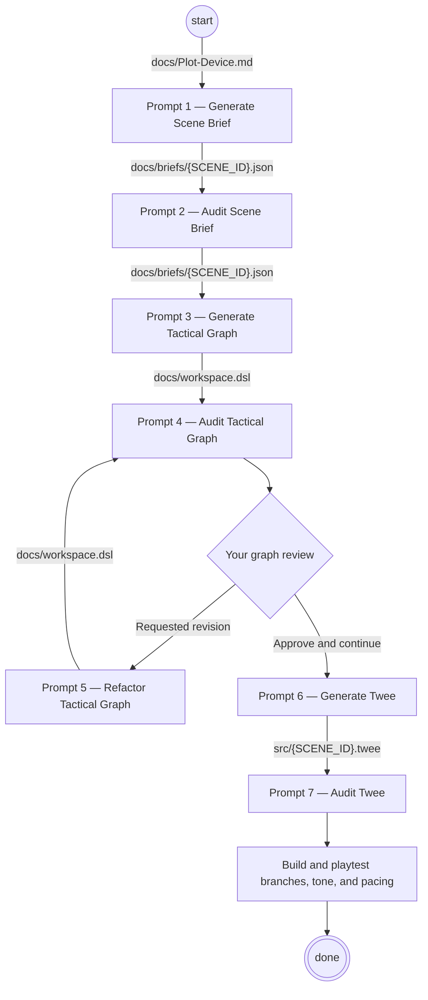

# Strangers In The Attic
<a href="https://kilogold.github.io/TwineListen/">

</a> 

A Twine narrative prototype.

> **ℹ️ Note:**  
> See the playable [demo site](https://kilogold.github.io/TwineListen/).
> 

## Key development constraints
1. The game has only two mechanics: gaze & listen.
2. Focus on emotional storytelling and psychological thriller.
3. Apply principles from "Aesthetics of Play" for narrative content.

## Game features
- Player perspective: First-person.
- Single NPC actor: a frail and melancholic elderly man named Leon.
- Player actor: a mysterious humanoid physical entity that keeps respawning.
- Static environment: dark attic setting.
- Core gameplay revolves around careful NPC + environment observation & listening.
- NPC is subject to attack the player if he feels misunderstood, judged, or ignored.
- Game over unlocks new progressive story passages.
- The story has multiple endings based on player interactions & NPC reactions.
- Player only nods and listens.

## Project details 
### Setup
- Install [RuleSync](https://rulesync.dyoshikawa.com/) version **16.30.2** (requires Node.js and npm):
  ```sh
  npm install -g rulesync@16.30.2
  rulesync generate
  ```
  Run `rulesync generate` after a fresh checkout and whenever the RuleSync sources change. It generates the ignored Codex and Cursor rules and skills. The version is documented rather than enforced by the repository.
- Use Codex or Cursor for AI-assisted development.
- Setup [Twine (Twee 3) Language](https://github.com/sgranade/twine-twee-language) plugin
  - [Build](https://github.com/sgranade/twine-twee-language?tab=readme-ov-file#building-your-game)
  - [Run](https://github.com/sgranade/twine-twee-language?tab=readme-ov-file#running-your-game)


### File structure
- [src](/src/): All Twee files for Twine narrative.
- [docs](/docs/): Story context for narrative generation. 
- [include](/include/): Assets bundled with the build.
- [tools](/tools/): Misc automations for development.
- [.rulesync](/.rulesync/): Source rules and skills used to generate Codex and Cursor configuration.

### AI Workflow
- **Run the scene workflow directly** with the [twine-workflow coordinator skill](/.rulesync/skills/twine-workflow/SKILL.md).
  - In Codex, invoke `$twine-workflow generate c01.s01` to run one scene with fresh author/reviewer subagents.
  - The workflow runs through graph review and pauses for your approval. After approving the graph, request continuation to Twee and playtest.
- **Run the workflow in a separate Git worktree** with the [twine-factory skill](/.rulesync/skills/twine-factory/SKILL.md).
  - Start with `$twine-factory start c01.s01 --base HEAD`.
  - One factory run stays open at a time.
  - Use `$twine-factory status` or `$twine-factory resume c01.s01` to pick up an open run.
  - After reviewing its graph, use `$twine-factory continue c01.s01 --approve <checkpoint-sha>`.
  - `$twine-factory close c01.s01` frees the slot and keeps the candidate.
- **Update the skills and worker profiles** under `.rulesync/skills/` and [.rulesync/subagents/](/.rulesync/subagents/), then run `rulesync generate`.
  - This installs skills for Codex and Cursor and generates the six Codex role profiles in `.codex/agents/`.
  - Each worker source contains its description, instructions, and Codex model and effort settings.



### Historical model trials per prompt
| Model         | P1 | P2 | P3 | P4 | P5 | P6 | P7 |
|---------------|----|----|----|----|----|----|----|
| GPT 5.4       | ✓  |    | ✓  |    | ✓  | ✓  |    |
| Opus 4.6      | ✓  |    | ✓  |    | ✓  | ✓  |    |
| Sonnet 4.6    |    | ✓  |    | ✓  |    |    | ✓  |
| GPT 5.3 Codex |    | ✓  |    | ✓  |    |    | ✓  |
